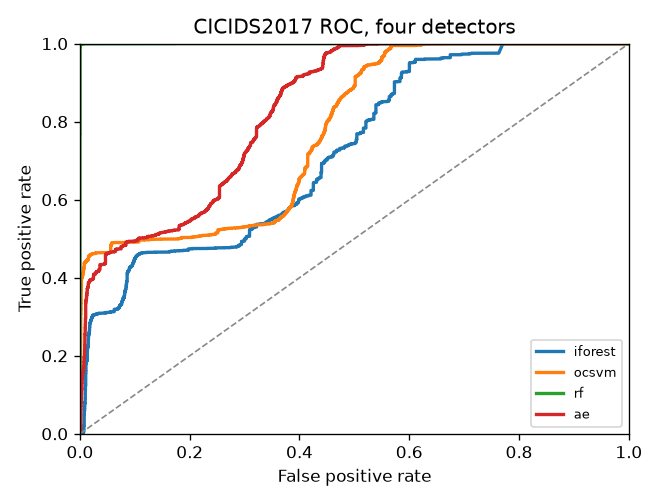

# NIDS-Lab

[](https://www.python.org/)
[](LICENSE)

A small lab for classical machine learning on network intrusion detection. Same public data, same metrics, a few standard detectors. The point is to show the numbers clearly, including where a method is weak.

This is a defensive, educational project. It does not generate attacks. It only scores traffic that is already in a public dataset.

What runs today is NSL-KDD and CICIDS2017, each with four detectors: Isolation Forest, One-Class SVM, Random Forest, and a plain dense autoencoder. The autoencoder is a normal dense network, not a VAE. This repo does not study model compression or detection latency.

## Quickstart

```bash
python -m pip install -e ".[dev]"
python -m nidslab download --dataset nslkdd
python -m nidslab download --dataset cicids2017
python -m nidslab run --dataset nslkdd --model iforest
python -m nidslab run-all --dataset all
```

`download --dataset nslkdd` pulls `KDDTrain+.txt` and `KDDTest+.txt` into `data/` (about 20 MB). If that mirror is blocked, put those two files in `data/` yourself.

`download --dataset cicids2017` pulls the public MachineLearningCSV zip (about 224 MB) and extracts the eight day files under `data/cicids2017/`. The raw files stay local. They are not part of the git repo.

`run-all --dataset all` writes `results/run_all.md` and `results/run_all.csv`. One dataset at a time is `run-all --dataset nslkdd` or `run-all --dataset cicids2017`.

## Architecture

```
public CSV
    |
    v
loader
    NSL-KDD: official KDDTrain+ and KDDTest+
    CICIDS2017: stream all 8 files, reservoir sample, then 80/20 split
    |
    v
encoder
    one-class models: fit on normal training rows only
    Random Forest: fit on every training row
    |
    v
detector
    iforest, ocsvm, plain autoencoder -> anomaly score
    random forest -> attack probability
    |
    v
precision, recall, F1, ROC-AUC, confusion matrix, ROC figure
```

## How a run is set up

- Train file: full `KDDTrain+` (125,973 rows). Test file: full `KDDTest+` (22,544 rows). The test file is never subsampled.
- `protocol_type`, `service`, and `flag` are one-hot encoded. Numeric fields are standardized.
- For Isolation Forest, One-Class SVM, and the autoencoder, that encoder is fit on normal training rows only. Attack rows in training are counted, then left out.
- Random Forest is the supervised reference. Its encoder is fit on every training row, and it sees the attack label.
- The positive class is any attack. `normal` is the negative class.
- One-Class SVM is the exception on training size. An RBF kernel cannot hold all 67,343 normal training rows, so it trains on 4,000 of them (seed 42). That sample is written into the result file.
- NSL-KDD comes from the 1998 DARPA / 1999 KDD Cup traffic, cleaned by Tavallaee et al. It is old. A high score here is not evidence about today's networks.

Thresholds, all fixed before looking at the test set:

| model | decision rule |
| --- | --- |
| iforest | sklearn contamination 0.01, 100 trees |
| ocsvm | RBF kernel, nu 0.01 |
| rf | attack probability 0.5, 100 trees |
| ae | 15 epochs, MSE, threshold = 99th percentile of reconstruction error on a 10% normal holdout |

ROC-AUC uses the continuous score, so it does not depend on those thresholds. Precision, recall, and F1 do. A strict threshold can show a high AUC and a modest recall at the same time. That is what happened here.

## NSL-KDD results

Seed 42. Scored on the full `KDDTest+`. Random Forest uses labels. The other three do not, so a higher Random Forest score is not a like-for-like win.

| model | setup | precision | recall | f1 | roc_auc |
| --- | --- | ---: | ---: | ---: | ---: |
| iforest | one-class, full normal train | 0.9789 | 0.5502 | 0.7045 | 0.9365 |
| ocsvm | one-class, 4000 normal rows | 0.9310 | 0.6482 | 0.7643 | 0.8824 |
| rf | supervised, full train | 0.9690 | 0.6331 | 0.7659 | 0.9598 |
| ae | one-class, full normal train | 0.9826 | 0.4304 | 0.5986 | 0.9567 |


## CICIDS2017 results

The eight MachineLearningCSV files were streamed: 2,271,320 BENIGN flows, 556,556 attack flows, and 2,867 rows dropped for missing or infinite values. Training does not use every row. A reservoir sample keeps 20,000 BENIGN and 20,000 attack rows (seed 42), then an 80/20 split. The raw data is not balanced, and CIC published no official train/test split. Train and test here are a random cut of the same days, so Random Forest can look almost perfect. That number is not a fair win over the one-class models, and it is not a claim about a future week of traffic.

Cite the data if you use it: Sharafaldin, Habibi Lashkari, and Ghorbani, ICISSP 2018.

| model | setup | precision | recall | f1 | roc_auc |
| --- | --- | ---: | ---: | ---: | ---: |
| iforest | one-class, 16000 BENIGN train rows | 0.9247 | 0.1227 | 0.2167 | 0.7264 |
| ocsvm | one-class, 4000 BENIGN rows | 0.9215 | 0.4640 | 0.6172 | 0.7786 |
| rf | supervised, balanced train sample | 0.9987 | 0.9968 | 0.9977 | 0.9999 |
| ae | one-class, 16000 BENIGN train rows | 0.9693 | 0.3390 | 0.5023 | 0.8338 |



## Layout

```
src/nidslab/data/nslkdd.py       NSL-KDD loader
src/nidslab/data/cicids.py       CICIDS2017 loader and sample
src/nidslab/models/iforest.py    Isolation Forest
src/nidslab/models/ocsvm.py      One-Class SVM
src/nidslab/models/rf.py         Random Forest
src/nidslab/models/autoencoder.py  plain dense autoencoder
src/nidslab/eval/metrics.py      precision, recall, F1, ROC-AUC
src/nidslab/eval/plots.py        ROC and confusion figures
src/nidslab/cli.py               download, run, run-all
```

## Limitations

- NSL-KDD is cleaned 1998/1999 traffic. A good score does not transfer to a current network.
- CICIDS2017 here is a balanced 20,000 / 20,000 sample, then a random 80/20 split of the same days. The raw files are mostly BENIGN, and there is no official train/test split. The Random Forest score near 1.0 is from that setup.
- One-Class SVM sees 4,000 normal training rows because an RBF kernel cannot hold the full normal set.
- Precision, recall, and F1 use a fixed threshold. ROC-AUC does not. A high AUC with a low recall means the ranking is useful and the chosen cut is strict.
- Attack types are collapsed into one positive class. The lab does not score each attack family on its own.
- The autoencoder is a plain dense network trained with mean squared error. It is not a VAE, and this repo does not measure model size or detection latency.
- Tests use tiny tables. They check the code, not the published metrics. The metrics above come from the real files.

## Tests

```bash
python -m pytest
```

The tests use tiny tables. They do not need the real NSL-KDD download.

## License

MIT. See [LICENSE](LICENSE).
