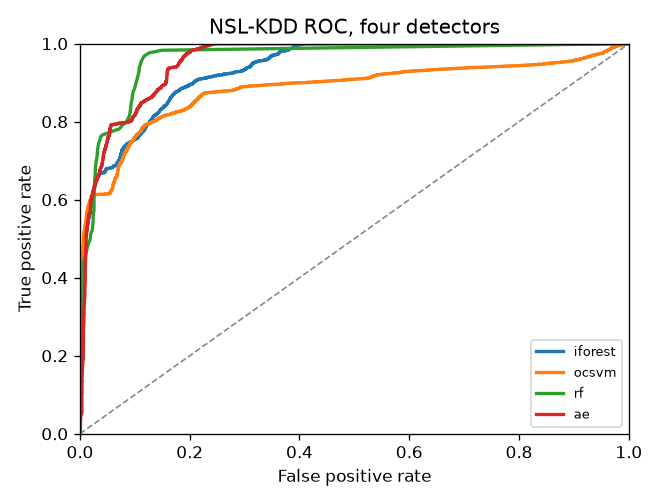

# NIDS-Lab

A small lab for classical machine learning on network intrusion detection. Same public data, same metrics, a few standard detectors. The point is to show the numbers clearly, including where a method is weak.

This is a defensive, educational project. It does not generate attacks. It only scores traffic that is already in a public dataset.

What runs today is NSL-KDD with four detectors: Isolation Forest, One-Class SVM, Random Forest, and a plain dense autoencoder. CICIDS2017 is next. The autoencoder is a normal dense network, not a VAE. This repo does not study model compression or detection latency.

## Quickstart

```bash
python -m pip install -e ".[dev]"
python -m nidslab download --dataset nslkdd
python -m nidslab run --dataset nslkdd --model iforest
python -m nidslab run-all --dataset nslkdd
```

`download` pulls the public `KDDTrain+.txt` and `KDDTest+.txt` files into `data/` (about 20 MB). If that mirror is blocked, download those two files from the University of New Brunswick NSL-KDD page and put them in `data/` yourself, then run the same commands.

`run` writes `results/nslkdd_<model>.json`, a short markdown note, a ROC curve, and a confusion matrix. `run-all` also writes `results/nslkdd_results.md`, `results/nslkdd_results.csv`, and `results/figures/nslkdd_roc_all.png`.

## How a run is set up

- Train file: full `KDDTrain+` (125,973 rows). Test file: full `KDDTest+` (22,544 rows). The test file is never subsampled.
- `protocol_type`, `service`, and `flag` are one-hot encoded. Numeric fields are standardized.
- For Isolation Forest, One-Class SVM, and the autoencoder, that encoder is fit on normal training rows only. Attack rows in training are counted, then left out.
- Random Forest is the supervised reference. Its encoder is fit on every training row, and it sees the attack label.
- The positive class is any attack. `normal` is the negative class.
- One-Class SVM is the exception on training size. An RBF kernel cannot hold all 67,343 normal training rows, so it trains on 4,000 of them (seed 42). That sample is written into the result file.
- NSL-KDD comes from the 1998 DARPA / 1999 KDD Cup traffic, cleaned by Tavallaee et al. It is old. A high score here is not evidence about today's networks.

Thresholds, all fixed before looking at the test set:

| model | decision rule |
| --- | --- |
| iforest | sklearn contamination 0.01, 100 trees |
| ocsvm | RBF kernel, nu 0.01 |
| rf | attack probability 0.5, 100 trees |
| ae | 15 epochs, MSE, threshold = 99th percentile of reconstruction error on a 10% normal holdout |

ROC-AUC uses the continuous score, so it does not depend on those thresholds. Precision, recall, and F1 do. A strict threshold can show a high AUC and a modest recall at the same time. That is what happened here.

## NSL-KDD results

Seed 42. Scored on the full `KDDTest+`. Random Forest uses labels. The other three do not, so a higher Random Forest score is not a like-for-like win.

| model | setup | precision | recall | f1 | roc_auc |
| --- | --- | ---: | ---: | ---: | ---: |
| iforest | one-class, full normal train | 0.9789 | 0.5502 | 0.7045 | 0.9365 |
| ocsvm | one-class, 4000 normal rows | 0.9310 | 0.6482 | 0.7643 | 0.8824 |
| rf | supervised, full train | 0.9690 | 0.6331 | 0.7659 | 0.9598 |
| ae | one-class, full normal train | 0.9826 | 0.4304 | 0.5986 | 0.9567 |



## Layout

```
src/nidslab/data/nslkdd.py       loader and preprocessing
src/nidslab/models/iforest.py    Isolation Forest
src/nidslab/models/ocsvm.py      One-Class SVM
src/nidslab/models/rf.py         Random Forest
src/nidslab/models/autoencoder.py  plain dense autoencoder
src/nidslab/eval/metrics.py      precision, recall, F1, ROC-AUC
src/nidslab/eval/plots.py        ROC and confusion figures
src/nidslab/cli.py               download, run, run-all
```

## Tests

```bash
python -m pytest
```

The tests use tiny tables. They do not need the real NSL-KDD download.

## License

MIT. See [LICENSE](LICENSE).
